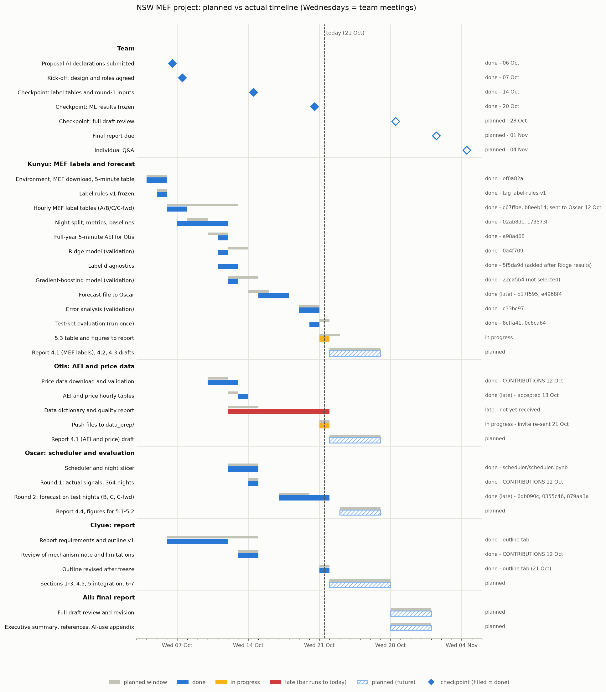
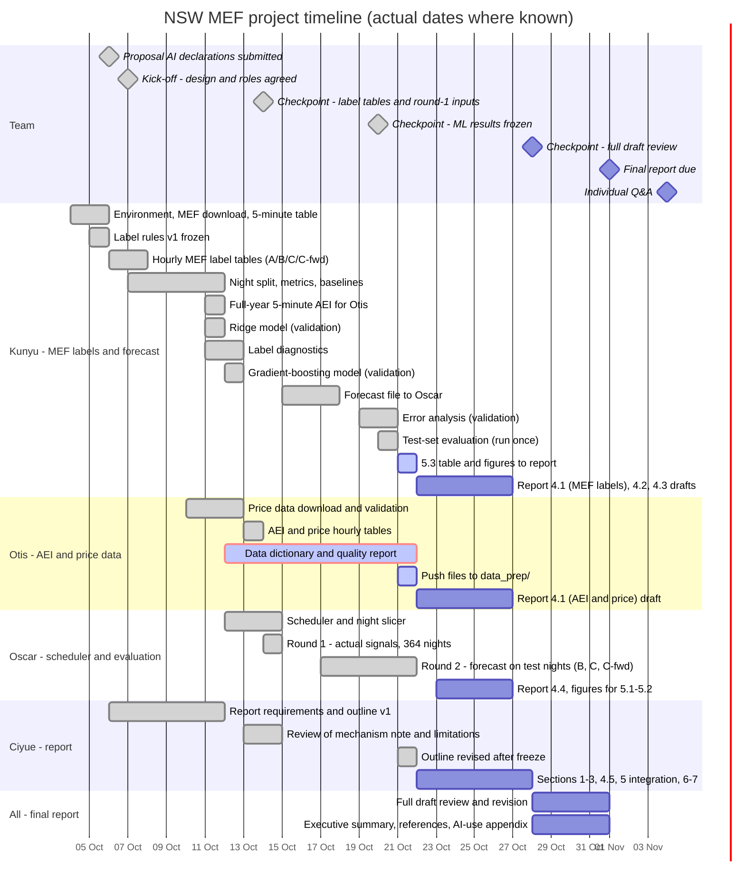

# Project timeline (Gantt chart)

Planned versus actual progress for the whole team, from kick-off to submission. Snapshot: **21 October 2026** (the results-freeze checkpoint). Wednesdays are team meetings.

- **Source of truth:** [`project_timeline.csv`](project_timeline.csv): one row per task, with planned dates, actual dates, status and evidence (a commit, tag or document).
- **Regenerate** after editing the CSV: `python docs/timeline/make_timeline.py` (rewrites the PNG and the chart below; update `TODAY` in the script first).
- **For the report appendix:** [`project_timeline.png`](project_timeline.png) shows each task's planned window (grey) above its actual bar.

## Interactive view (renders on GitHub)
Bars use actual dates where known; late items run to today; future items use planned dates.

<!-- MERMAID:START -->

<!-- MERMAID:END -->

## Notes
- **Dates after 21 October are proposed**, pending team agreement (in particular Oscar's round-2 deadline of 23 October).
- **Status meanings:** *done (late)* = finished after its planned end; *late* = planned end has passed and the item is not yet received; *in progress* = started, planned end not yet passed.
- ML results are frozen under the git tag `results-v1`; anything run after the freeze goes to the report appendix only.
